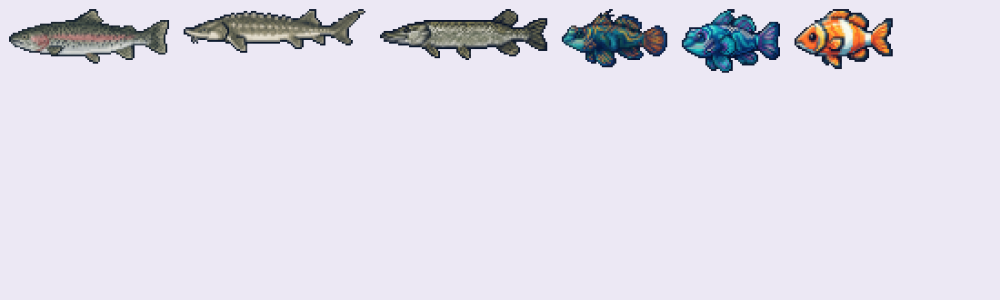
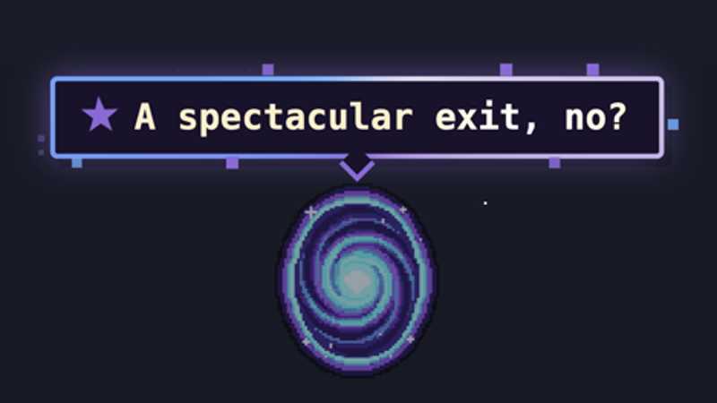
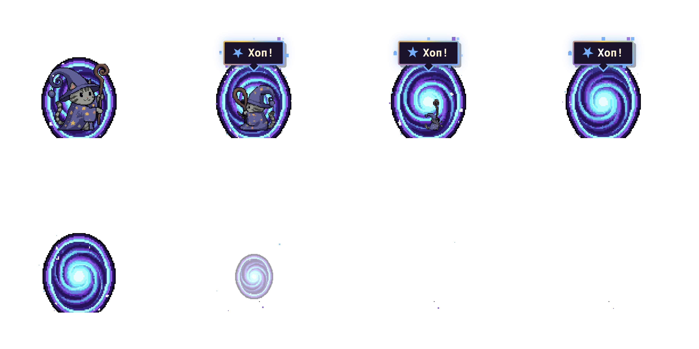
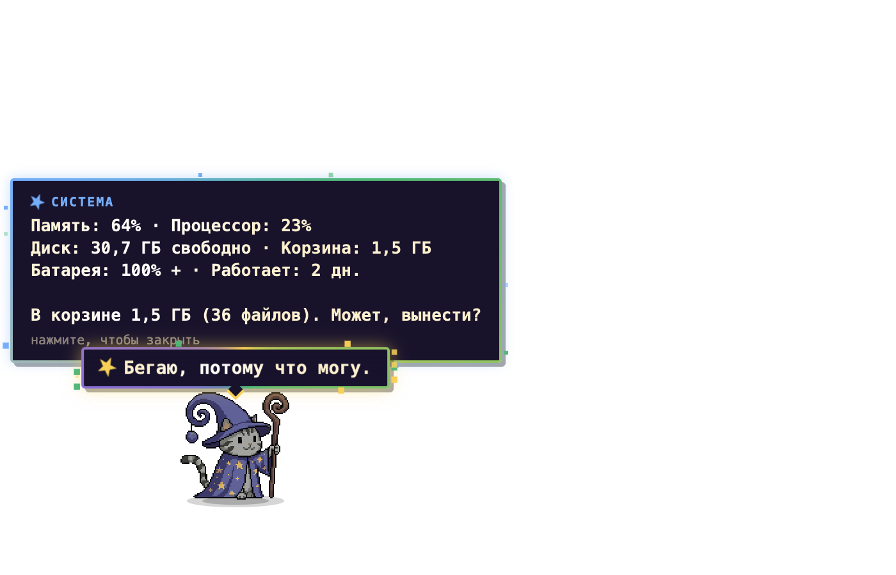
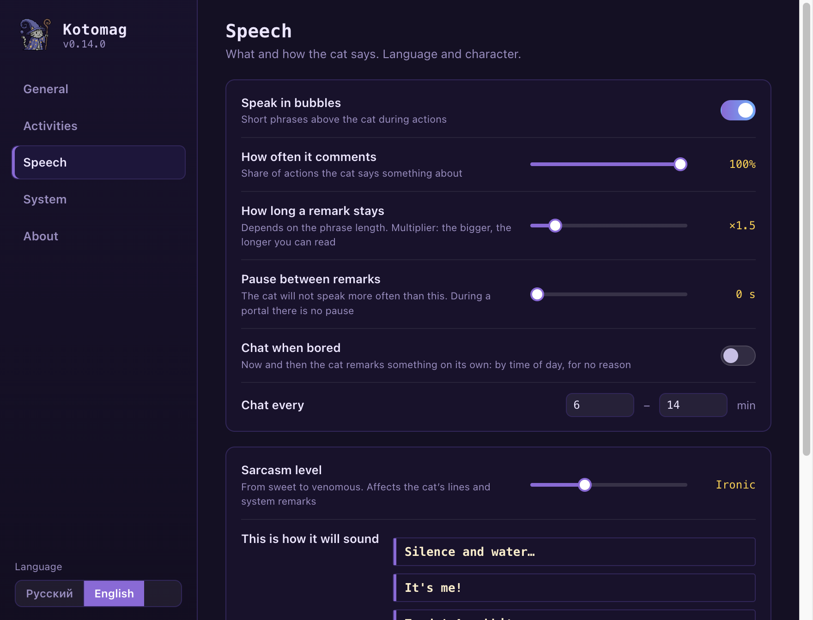

# Котомаг

[English](README.md)

Пиксельный **кот-волшебник** внизу вашего экрана. Гуляет, рыбачит, варит зелья (иногда они взрываются), прыгает через порталы,
гоняется за красной лазерной точкой, рассказывает анекдоты и тихо приглядывает за компьютером: корзина, память, процессор,
диск, батарея и то, сколько вы работаете без перерыва. Реплики на **русском или английском**, а ещё есть **ручка сарказма**
от милого кота до ядовитого.

| Рыбалка (шесть рыб, нарисованных для игры) | Портал |
|---|---|
|  |  |

| Реплики | Отчёт о системе |
|---|---|
|  |  |



## Возможности

- **17 занятий**, которые кот затевает сам или по правому клику: клубок, кофе, книга, танец, рыбалка, фокус со шляпой,
  зелье, зевок, левитация, мыльные пузыри, охота на мышку, двойники, салют, бег на четвереньках, лазерная указка, порталы, радость.
  Каждое можно выключить или сделать реже и чаще.
- **Около 1200 реплик** (по 600 на язык) в трёх тонах: милые, с иронией, саркастичные. Уровень сарказма меняет смесь,
  а одна и та же фраза подряд не повторяется. От скуки кот болтает с учётом времени суток.
- **Системные замечания**: размер корзины, занятая память (и какое приложение виновато), нагрузка процессора, место на диске,
  низкий заряд батареи, давняя перезагрузка и напоминание о перерыве после долгой работы. Пороги настраиваются, всё считается на вашем компьютере.
- **Окно настроек** (правый клик по коту, «Настройки…»): поведение, занятия, реплики, система, о программе; тумблеры, частоты,
  «не беспокоить» с расписанием, автозапуск, горячая клавиша.
- **Лазерная указка**: кот гоняется за красной точкой у курсора. Горячая клавиша по умолчанию `Cmd/Ctrl+Alt+L` (меняется) или Alt-клик по коту.
- Кота можно таскать мышкой и гладить кликом. Он следит за курсором и засыпает, если долго нет дел (сначала зевает).
- Шутки и смешные картинки с котами по запросу и иногда сами. Они берутся из открытых источников
  (rzhunemogu.ru, jokeapi.dev, meme-api.com, thecatapi.com) **только когда кот шутит**. Грубые шутки по умолчанию отфильтрованы.
  Выключите «Анекдоты и картинки», и сетевых запросов не будет совсем.

## Установка

Скачайте архив для своей системы на странице [Releases](../../releases) и распакуйте.

- **macOS** (Apple silicon и Intel): `Kotomag-mac.zip`, внутри `Kotomag.app`. Программа подписана локально (не нотаризована):
  правый клик, «Открыть», либо один раз выполните `xattr -cr Kotomag.app`.
  Горячую клавишу отслеживает небольшая вспомогательная программа, особых разрешений не нужно.
- **Windows**: `Kotomag-win.zip`, запустите `Kotomag.exe`. SmartScreen может предупредить о неизвестном издателе (подписи нет).
  Значок в трее открывает настройки или закрывает программу.

Настройки лежат в папке данных пользователя (`config.json`, `log.txt`).

## Сборка из исходников

```bash
npm install
npm start                   # запуск из исходников
bash scripts/build-mac.sh   # macOS: dist/Kotomag.app и dist/Kotomag-mac.zip (нужны Xcode command line tools)
npm run dist:win            # zip для Windows через electron-builder
```

Устройство: `src/main.js` (окно, трей, настройки, горячая клавиша), `src/sysmon.js` (системные проверки для macOS, Windows и Linux),
`src/config.js` (значения по умолчанию и проверка), `src/ui/` (кот, банк реплик в `phrases*.js`, кадры),
`src/settings/` (окно настроек), `native/keys.c` (опрос горячей клавиши на macOS).

## Лицензия

Код: MIT (`LICENSE`). Графика (кадры, анимации, рыбы, иконка): © 2026 Asfsag, все права защищены (`LICENSE-ART.md`).
